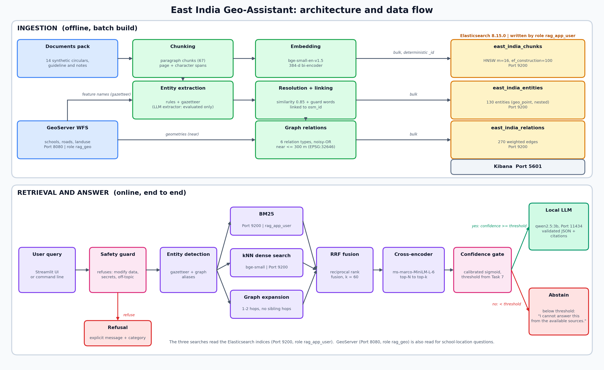

# East India Geo-Assistant (GeoRAG)

An enterprise-grade, 100% local **Geo-Spatial Retrieval-Augmented Generation (GeoRAG)** assistant for spatial policy, regulatory circulars, and educational infrastructure queries across East India.

Built using **Elasticsearch**, **GeoServer (WFS/GeoJSON)**, **Ollama (Qwen 2.5)**, **Sentence-Transformers (BGE & MiniLM Cross-Encoder)**, and **Streamlit**.

---

## Architecture Overview



```
                            +----------------------------------------+
                            |            Streamlit UI / CLI          |
                            +----------------------------------------+
                                                |
                                                v
                            +----------------------------------------+
                            |          Query Safety Shield           |
                            |   (Injection Defense, Guardrails)      |
                            +----------------------------------------+
                                                |
                     +--------------------------+--------------------------+
                     |                                                     |
                     v                                                     v
      +-----------------------------+                       +-----------------------------+
      |    Elasticsearch Engine     |                       |      GeoServer Engine       |
      |   - BM25 Lexical            |                       |   - OGC WFS Protocol        |
      |   - Dense HNSW Vectors      |                       |   - GeoPackage Layer Store  |
      |   - Reciprocal Rank Fusion  |                       |   - Spatial Attributes      |
      |   - Knowledge Graph Graph-RAG|                      |   - Schools / Roads / Land  |
      +-----------------------------+                       +-----------------------------+
                     |                                                     |
                     +--------------------------+--------------------------+
                                                |
                                                v
                            +----------------------------------------+
                            |      Cross-Encoder Reranker Pool       |
                            |       (ms-marco-MiniLM-L-6-v2)         |
                            +----------------------------------------+
                                                |
                                                v
                            +----------------------------------------+
                            |   Confidence Calibration & Decision    |
                            | (Temperature Scaling & Selective Refuse|
                            +----------------------------------------+
                                                |
                                                v
                            +----------------------------------------+
                            |       Ollama Local LLM (Qwen 2.5)      |
                            |  Strict Grounded Citations & Answers   |
                            +----------------------------------------+
```

---

## Key Features

- **100% Local Execution**: No external or paid APIs. Runs entirely on CPU with local models (Ollama Qwen 2.5:3b, BGE embeddings, MiniLM Cross-Encoder).
- **Hybrid Search + Reciprocal Rank Fusion (RRF)**: Combines dense vector similarity (`BAAI/bge-small-en-v1.5`) with exact lexical BM25 matching.
- **Knowledge Graph Integration**: Extracts and indexes entities and multi-hop relationships (`supersedes`, `located_in`, `governs`) into an Elasticsearch relation store to resolve outdated circulars and trace regulatory lineage.
- **Geo-Spatial WFS Enrichment**: Integrates with GeoServer over authenticated WFS to cross-reference administrative land use, school locations, and infrastructure spatial features.
- **Cross-Encoder Reranking**: Scores and reorders candidate passages using `ms-marco-MiniLM-L-6-v2` with deterministic tie-breaking.
- **Calibrated Confidence & Abstention**: Employs Platt temperature scaling on retrieval signals to compute calibrated confidence scores. Automatically abstains with safe fallback when query evidence is insufficient.
- **Enterprise Security**: Enforces role-based least privilege:
  - Elasticsearch: `rag_app_user` with zero cluster admin privileges.
  - GeoServer: `rag_geo` with read-only WFS catalog challenge mode.
- **Adversarial Safety Defense**: Built-in regex and heuristic protection against prompt injection, mutation attempts, and secret harvesting.

---

## Repository Structure

```
geoassistant/
|-- app/                    # Application runtime & interfaces
|   |-- pipeline.py         # End-to-end GeoRAG orchestration pipeline
|   `-- streamlit_app.py    # Interactive Streamlit web interface
|-- data_pack/              # Regulatory documents, GeoPackage & benchmark gold standards
|   |-- data/               # Circulars (CIR-001 to CIR-012) & east_india.gpkg
|   `-- eval/               # Gold evaluation sets (entities, relations, retrieval)
|-- diagram/                # System architecture diagrams (PNG & PDF)
|-- docker-compose.yml      # Multi-container setup for Elasticsearch, Kibana, and GeoServer
|-- es/                     # Elasticsearch index schemas, mappings & security setup
|-- evalsuite/              # Evaluation benchmarks, metrics & verification suite
|   |-- ann_benchmark.py    # Vector ANN vs exact search evaluation
|   |-- eval_dev.py         # Dev question evaluation
|   |-- eval_rerank.py      # Cross-encoder evaluation
|   |-- test_safety.py      # Prompt injection and safety tests
|   `-- selfcheck.py        # System integrity self-check script
|-- evidence/               # Benchmark outputs, metric logs, and screenshots
|-- geoserver/              # Layer publication scripts and role policies
|-- ingest/                 # Document parsing, chunking, embedding & KG indexing
|-- retrieve/               # Hybrid retrieval, Cross-Encoder reranker & graph traversal
|-- requirements.txt        # Python package dependencies
`-- PROJECT DOCUMENT.md     # In-depth technical engineering documentation
```

---

## Tech Stack

| Component | Technology | Version |
|---|---|---|
| **Vector & Search Store** | Elasticsearch (Docker) | 8.15.0 |
| **GIS Spatial Server** | GeoServer (Docker) | 2.26.1 |
| **Local LLM** | Ollama (`qwen2.5:3b`) | Native Windows / Linux |
| **Embeddings** | `BAAI/bge-small-en-v1.5` | 384-dimensional |
| **Reranker** | `cross-encoder/ms-marco-MiniLM-L-6-v2` | Sentence-Transformers |
| **Application Layer** | Python 3.12 + Streamlit | 3.12+ |

---

## Getting Started

### 1. Prerequisites
- Docker & Docker Compose
- Python 3.12+
- [Ollama](https://ollama.ai/) installed locally

Pull the required LLM model via Ollama:
```bash
ollama pull qwen2.5:3b
```

### 2. Environment Configuration
Clone the repository and copy the environment template:
```bash
cp .env.example .env
```
Fill in the passwords in `.env` (matches your local Docker and service configuration).

### 3. Start Infrastructure Services
Launch Elasticsearch, Kibana, and GeoServer:
```bash
docker compose up -d
```

Verify service availability:
- Elasticsearch: `http://localhost:9200`
- GeoServer: `http://localhost:8080/geoserver`
- Kibana: `http://localhost:5601`

### 4. Python Environment Setup
Create and activate a virtual environment:
```powershell
python -m venv venv
.\venv\Scripts\activate
pip install -r requirements.txt
```

---

## Ingestion & Pipeline Setup

Initialize the search indices, extract entities, build the knowledge graph, and publish layers:

```powershell
# 1. Initialize Elasticsearch security & roles
python es/setup_security.py

# 2. Publish GeoServer spatial layers
python geoserver/publish_layers.py

# 3. Chunk documents
python ingest/chunker.py

# 4. Generate embeddings and index chunks into Elasticsearch
python ingest/index_chunks.py --model bge --index-type hnsw

# 5. Extract entities and index to knowledge base
python ingest/resolve_and_index.py --source baseline

# 6. Build knowledge graph relations
python ingest/build_relations.py
```

---

## Running the Application

### Interactive Web UI (Streamlit)
```powershell
streamlit run app/streamlit_app.py
```
Open [http://localhost:8501](http://localhost:8501) in your browser to query circulars, view grounded citations, inspect confidence scores, and preview geospatial overlays.

### CLI Query Mode
```powershell
# Verify user privileges and connectivity
python app/pipeline.py --whoami

# Run a query via CLI
python app/pipeline.py --query "What are the affiliation criteria for secondary schools under Circular 002?"
```

---

## Running Evaluations

The repository includes a comprehensive evaluation suite:

```powershell
# Retrieval metrics (nDCG@5, Recall@5)
python evalsuite/eval_retrieval.py

# Reranker evaluation
python evalsuite/eval_rerank.py

# Confidence calibration (ECE, Brier score)
python evalsuite/eval_calibration.py

# Safety guardrail & injection tests
python evalsuite/test_safety.py

# End-to-end dev benchmark
python evalsuite/eval_dev.py

# Comprehensive repository selfcheck
python evalsuite/selfcheck.py
```

---

## Security & Guardrails

1. **Least-Privilege Roles**: The runtime application accesses Elasticsearch strictly through the `rag_app_user` service account (zero cluster admin privileges) and GeoServer through `rag_geo` (read-only WFS).
2. **Catalog Challenge Mode**: Unauthenticated requests to GeoServer receive `401 Unauthorized` without leaking catalog metadata.
3. **Adversarial Hardening**: Input prompts and retrieved passages are scanned for known jailbreaks, prompt leaks, and secret extraction attempts before entering LLM context.

---

## Detailed Technical Documentation

For complete mathematical formulations, calibration plots, failure analysis, and benchmark evidence, please refer to:
- [PROJECT DOCUMENT.md](PROJECT%20DOCUMENT.md)
